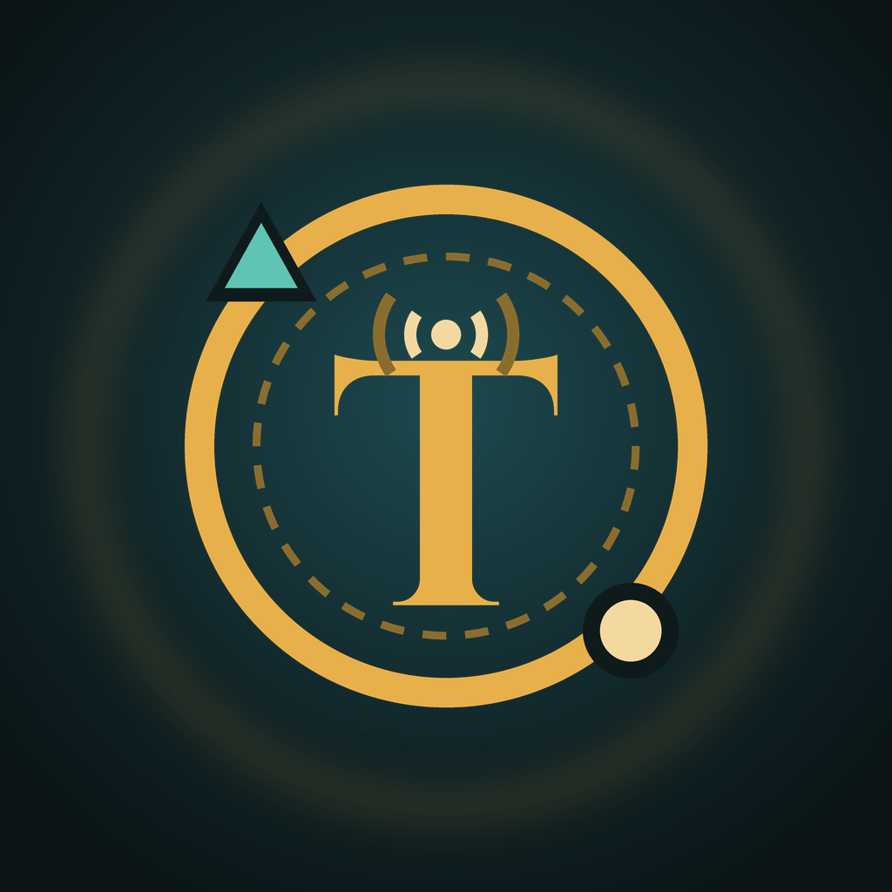

# Trace

*For learning purpose only.* Utvecklare: Claes Sundman S.N.C AB.

Android-app som loggar vilka mobilmaster telefonen hör, ritar ut dem på OpenStreetMap
och varnar för tre sorters avvikelser:

- **Ny cell**: ett cell-ID som inte finns i OpenCellID:s databas och som appen aldrig sett förut.
- **Rör sig**: samma cell-ID hörs på platser mer än 50 km isär inom ett dygn,
  eller långt från sin registrerade position. Spåret ritas som en streckad röd linje med tidpunkter.
- **Nedgradering**: telefonen går från 4G/5G ner till 3G eller 2G.

Avvikande antenner visas som **trianglar** på kartan, med en färg per orsak:

| Triangel | Betyder |
|---|---|
| Röd | Rör sig: samma cell-ID hörs mer än 50 km isär inom ett dygn. Spåret ritas som en streckad linje. |
| Rosa | Onormal styrka: starkare än −55 dBm, eller minst 20 dB starkare än cellens vanliga nivå. |
| Grön | Kortvarig: telefonen anslöt, cellen fanns högst 15 minuter och försvann medan du var kvar på platsen. |
| Gul | Ny: cell-ID:t saknas i OpenCellID. |

Inget av detta bevisar att en IMSI-catcher finns i närheten. De flesta avvikelser har vanliga
förklaringar, som nya master, ombyggnader i nätet eller mobila basstationer vid evenemang.

## Bygga och installera

1. Installera [Android Studio](https://developer.android.com/studio).
2. Välj **File → Open** och öppna den här mappen. Vänta tills Gradle-synkningen är klar.
3. Slå på utvecklaralternativ och USB-felsökning på telefonen
   (Inställningar → Om telefonen → tryck sju gånger på Versionsnummer).
4. Anslut telefonen och tryck på **Run**.

Appen kräver Android 10 eller nyare. Den fungerar inte på iPhone.

## Nycklar

### Git-nyckel (hämta och pusha från din dator)

Kör skriptet på datorn du ska jobba från:

- **Windows:** `powershell -ExecutionPolicy Bypass -File .\skapa-git-nyckel.ps1`
- **macOS / Linux:** `./skapa-git-nyckel.sh`

Skriptet skapar en SSH-nyckel i din hemmapp, kopierar den publika delen, öppnar
GitHubs sida för nya nycklar och testar anslutningen när du har sparat den.
Den privata nyckeln (`id_ed25519` utan ändelse) stannar på datorn och ska aldrig delas.

Har du inte klonat repot än kan du ladda ner skriptet från GitHub och köra det fristående.

### OpenCellID-nyckel (referensdata)

För att kunna avgöra vad som är en *ny* cell behöver appen veta vilka celler som redan finns.

1. Skapa ett gratis konto på [opencellid.org](https://opencellid.org) och kopiera din API-nyckel.
2. I appen: **Mer → OpenCellID-nyckel**, klistra in och tryck **Spara**.
3. **Mer → Ladda ner Sverige från OpenCellID**. Appen hämtar alla svenska celler (MCC 240)
   och lägger dem i den lokala databasen.

Nyckeln sparas bara i appen på telefonen. Säkerhetskopiering är avstängd, så den följer inte
med till molnet. OpenCellID begränsar antalet nedladdningar per dag.

Har du redan laddat ner `240.csv.gz` själv kan du läsa in den med **Mer → Importera fil**.

### Signeringsnyckel (release-APK)

För att bygga en signerad release-version, till exempel för att installera appen utan
Android Studio eller dela den med någon annan:

- **macOS / Linux:** `./skapa-signeringsnyckel.sh`
- **Windows:** `powershell -ExecutionPolicy Bypass -File .\skapa-signeringsnyckel.ps1`

Skriptet skapar `nycklar/cellkarta-release.jks` och `keystore.properties` med ett slumpat
lösenord. Gradle hittar dem automatiskt. Bygg sedan med **Build → Generate Signed App Bundle / APK**
eller `./gradlew assembleRelease`.

Båda filerna står i `.gitignore` och laddas aldrig upp till GitHub.
**Säkerhetskopiera dem**, till exempel i en lösenordshanterare. Förlorar du nyckeln kan du inte
släppa uppdateringar med samma signatur.

## Använda kartan

1. Tryck **Starta** och godkänn plats och notiser.
2. Gå gärna ut. När GPS:en hittar dig zoomar kartan in på dig.
3. Varje cell telefonen hör blir en **blå prick** på sin uppskattade position.
   Cellen du är ansluten till just nu har en större blå ring.
4. Tryck på en prick för att se cell-ID och hur många gånger den har hörts.
5. Med OpenCellID-data (Mer → Ladda ner Sverige) visas även **grå prickar** för kända master,
   ihopslagna till siffror när du zoomar ut.

Gula trianglar, röda linjer och lila romber dyker bara upp när något ovanligt händer.

## Uppdateringar

Under **Mer → Inställningar → Updates** ser du vilken version du har och kan söka efter en ny.
Appen söker också automatiskt en gång per dygn, och det går att stänga av.
En ny version laddas ner i webbläsaren och installeras ovanpå den gamla, så dina data finns kvar.

För att det ska fungera måste varje bygge signeras med samma nyckel. Gör så här en gång:

1. Kör `skapa-signeringsnyckel.ps1` (Windows) eller `./skapa-signeringsnyckel.sh` (Mac/Linux).
2. Öppna `nycklar/github-hemligheter.txt` som skriptet skapar.
3. På GitHub: repot → **Settings → Secrets and variables → Actions → New repository secret**.
   Lägg in `KEYSTORE_PASSWORD` och `KEYSTORE_B64` med värdena från filen.
4. Radera `github-hemligheter.txt`.

Nästa bygge signeras då med din nyckel. Utan hemligheterna byggs en testversion som måste
avinstalleras före varje uppdatering.

## Sparade celler

Varje cell-ID som telefonen hör sparas med tid, GPS-position och signalstyrka.
Tryck på **Celler** för att se listan. Där kan du

- söka på cell-ID,
- filtrera på avvikelser, nya celler, celler som rör sig eller celler som saknas i referensdatan,
- trycka på en cell för detaljer, kopiera dess ID eller visa den på kartan,
- spara listan som CSV med **Spara listan**.

Cell-ID:t har samma format som OpenCellID: `radio:mcc:mnc:område:cell`,
till exempel `LTE:240:1:61003:12345678`.

**Mer → Exportera mätlogg** sparar varje enskild mätning som CSV.

## Justera känsligheten

| Inställning | Fil | Standard |
|---|---|---|
| Avstånd för "rör sig" | `Detector.kt`, `MOVE_KM` | 50 km |
| Gräns för onormal styrka | `Detector.kt`, `STRONG_LTE_NR_DBM`, `STRONG_JUMP_DB` | −55 dBm, 20 dB |
| Kortvarig cell | `Detector.kt`, `SHORT_MAX_DURATION_MS`, `SHORT_GONE_MS` | 15 min, 30 min |
| Hur ofta cellerna läses | `CellMonitorService.kt`, `INTERVAL_MS` | 15 s |
| Kräv GPS-noggrannhet | `CellMonitorService.kt`, `MAX_ACCURACY_M` | 100 m |
| Zoom där enskilda master visas | `MainActivity.kt`, `DETAIL_ZOOM` | 11 |

Får du falsklarm om celler som rör sig i glesbygd, där master kan höras på långt håll,
höj `MOVE_KM`.

## Begränsningar

- Appen ser bara det Android visar för vanliga appar. Den kan inte se om nätet begär ditt IMEI
  eller stänger av krypteringen. Det kräver åtkomst till modemet.
- Grannceller som saknar fullständigt ID hoppas över.
- En telefon kan inte mäta var en antenn står. Positionen uppskattas från var du var när du hörde
  cellen, viktat efter signalstyrkan.
- GPS och avläsning var 15:e sekund drar batteri. Stoppa övervakningen när du inte behöver den.
- Kartan använder OpenStreetMaps öppna kartplattor. Följ deras
  [användarvillkor](https://operations.osmfoundation.org/policies/tiles/) och ladda inte ner stora
  områden i förväg.

Kartdata © OpenStreetMap-bidragsgivare. Celldata © OpenCellID, CC BY-SA 4.0.

## Utseende

Trace delar tema med Direct, Alif och USB: mörk petroleumgrön bakgrund, guld och mint,
Cinzel i ordmärket och Plus Jakarta Sans i texten. Ikonerna ritas med `python3 scripts/make-icons.py`.
Typsnitten är licensierade under SIL Open Font License.
